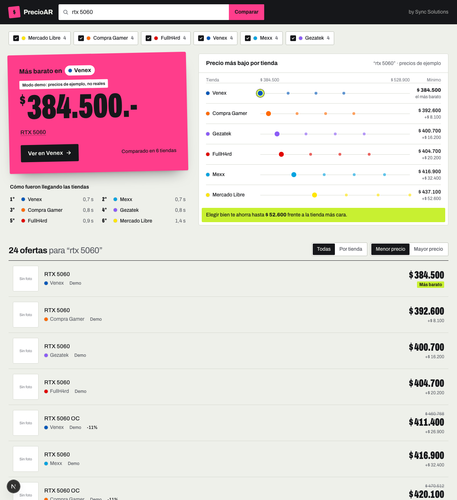

# Pesito — Comparador de precios de hardware

Buscás un producto una vez y ves el precio en **Mercado Libre, Compra Gamer, RocketHard, Mexx, Gezatek, Frávega, Goldentech y Space Gamer**, con el más barato resaltado y un resumen de precio mínimo por tienda. Además guarda el historial de precios y te avisa por mail cuando algo baja del precio que elegiste.



Además, **Armá tu PC** (`/armar`): elegís pieza por pieza (procesador, mother, RAM, placa de video, disco, fuente y gabinete) al mejor precio, con chequeo de compatibilidad (socket, DDR4/DDR5, potencia de la fuente) y una PC en 3D que se va armando. También puede armarla sola a partir de tu presupuesto y uso, y el armado se comparte por link.

Next.js 16 (App Router) · TypeScript · Tailwind 4 · Cheerio · Three.js · Vitest

## Correr local

```bash
npm install
cp .env.example .env.local   # opcional: Mercado Libre, base de datos, mails
npm run dev                  # http://localhost:3000
```

`DEMO_MODE=1 npm run dev` muestra precios de ejemplo sin consultar ninguna tienda (útil para demos o screenshots).

## Tests

```bash
npm test            # unitarios: texto/precios, parsers con HTML guardado, API en modo demo, lógica del armado
npm run test:live   # smoke test contra las tiendas reales (avisa si alguna cambió su HTML o bloquea la IP)
```

GitHub Actions corre typecheck, lint, tests y build en cada push (`.github/workflows/ci.yml`).

Los fixtures de `tests/fixtures/` son HTML real recortado (Gezatek, RocketHard, Mexx, Frávega, Space Gamer; la respuesta JSON de Goldentech) o sintético cuando la tienda bloquea scripts (listado de Mercado Libre).

## Cómo funciona

```
Navegador ──► /api/search/[tienda]?q=...   (una request por tienda, en paralelo)
                    │
                    ├─ cache en memoria 10 min (evita martillar las tiendas)
                    ├─ adapter de la tienda  → Product[]
                    └─ filtro: el título tiene que tener todas las palabras buscadas
```

Cada tienda carga por separado, así la que responde primero aparece primero y si una falla las demás siguen andando.

| Tienda | Cómo se obtiene | Archivo |
|---|---|---|
| Compra Gamer | JSON público del catálogo completo (`static.compragamer.com/productos`, ~2 MB) cacheado 15 min y filtrado en el server | `src/lib/stores/compragamer.ts` |
| Mexx | HTML de `/buscar/?p=` (deduplica por número de artículo) | `mexx.ts` |
| Gezatek | HTML de `/buscar/?q=`; datos en `data-id / data-nombre / data-precio` (plataforma qloud, parser compartido en `qloud.ts`) | `gezatek.ts` |
| RocketHard | Misma plataforma que Gezatek: `/buscar/?q=`, precio especial en `data-precio` y precio con Mercado Pago en `.precio_mp` | `rockethard.ts` |
| Goldentech | Store API pública de WooCommerce (`/wp-json/wc/store/v1/products?search=`), precios en centavos | `goldentech.ts` |
| Space Gamer | HTML de `/Buscar/{texto}`; datos en `data-id / data-nombre` y `.itembig-current-price` | `spacegamer.ts` |
| Frávega | HTML de `/l/?keyword=`; el listado sale del JSON de `__NEXT_DATA__` (estado de Apollo) | `fravega.ts` |
| Mercado Libre | API oficial con token (`ML_CLIENT_ID` + `ML_CLIENT_SECRET`); sin credenciales intenta el HTML del listado | `mercadolibre.ts` |

### Mercado Libre

La búsqueda pública de la API (`/sites/MLA/search`) devuelve **403 sin token**, y el listado web suele pedir login a tráfico automatizado. Para que ML funcione bien:

1. Creá una app en <https://developers.mercadolibre.com.ar/devcenter>.
2. Copiá `Client ID` y `Client Secret` a `.env.local`.

Si la búsqueda sigue en 403 con token, el adapter usa el catálogo (`/products/search` + precio de la buy box).

### Armado de PC

| Qué | Dónde |
|---|---|
| Categorías y filtros (descarta combos, servicios, accesorios y precios fuera de escala) | `src/lib/builder/parts.ts`, `build.ts` |
| Specs leídas del título: socket, DDR, watts, gráficos integrados | `src/lib/builder/specs.ts` |
| Compatibilidad y avisos | `src/lib/builder/compat.ts` |
| Armado por presupuesto (optimizador) | `src/lib/builder/budget.ts` |
| Escena 3D (Three.js, se carga aparte) | `src/components/pc3d/` |

Las tiendas no publican specs estructuradas, así que la compatibilidad es una heurística sobre el título: cuando no se puede leer, la UI pide verificar en la tienda.

**Por presupuesto** el armado arranca del más barato compatible y, ronda por ronda, sube un escalón la pieza que más rinde por peso para el uso (gaming: placa de video; edición: procesador y memoria), hasta agotar el presupuesto. Cada escala (procesadores por plataforma AM4/AM5/LGA1700, placas, RAM, disco) tiene un puntaje relativo; en gaming la placa no suma por encima de lo que el procesador puede aprovechar. Mother, cooler, fuente y gabinete salen de lo elegido. Se puede preferir AMD o Intel y marcar piezas que ya tenés (se guardan en el link como `=`). Para procesadores y placas solo vale el modelo exacto: "Ryzen 5 5600" no es un 5600G ni un 5600T. Las búsquedas van de a 6 para no saturar a las tiendas.

**Usados**: los títulos con usado, reacondicionado, open box, outlet o de exhibición se marcan (`isUsed` en `text.ts`); el comparador los oculta salvo que los incluyas, y no cuentan para el historial, las bajas, las alertas ni el armador.

**Memorias de notebook**: si la búsqueda no pide "sodimm" o "notebook", las SODIMM se marcan (`isNotebookRam`) y se tratan igual que los usados: ocultas en el comparador y fuera del historial, las bajas y las alertas (`isComparable` en `types.ts`). Sin esto, "ddr5 16gb" daba como más barata una memoria que no entra en una PC de escritorio.

### Historial y alertas de precio

Cada búsqueda guarda el precio más bajo del día por tienda (`/api/historial` arma el gráfico). Con `DATABASE_URL` se usa Postgres (las tablas se crean solas); sin eso, un archivo en `.data/`.

Las alertas ("avisame si baja de $X") no piden cuenta:

1. `POST /api/alertas` la crea **pendiente** y manda un mail con el link de confirmación (Resend). Así nadie puede anotar el mail de otro.
2. El link abre `/api/alertas/confirmar`, que pide apretar un botón: los servidores de mail que abren links para revisarlos no la activan solos.
3. `/api/cron` corre una vez por día (`vercel.json`): revisa las tiendas (monitor), vuelve a buscar lo que se sigue (alertas por mail y avisos push), de a tandas y con tiempo límite, y con el tiempo que sobra refresca las 20 búsquedas más populares que todavía no tienen precio de hoy. Lo que no entra sigue al otro día, empezando por lo revisado hace más tiempo.
4. Cada mail trae el link de baja (`/api/alertas/baja`).

Límites contra abuso: 5 alertas por hora por IP, 3 mails de confirmación por día al mismo mail y 20 alertas activas por mail. El ranking de armados populares valida cada armado y lo cuenta una vez por día por IP.

### Duelos, alternativas y "¿comprar ahora?"

- **Tabla de rendimiento** (`src/lib/perf.ts`): puntaje relativo y aproximado de placas y procesadores (juegos y edición). Solo sirve para compararlos entre sí; la UI siempre lo aclara. La usan el armado por presupuesto, las alternativas y los duelos.
- **Antes de comprar, mirá** (`/api/alternativas`, `src/lib/alternatives.ts`): al buscar una placa o un procesador de la tabla, propone uno que rinde parecido por menos (o, si no hay, uno que rinde un poco menos y sale bastante menos) y un salto que rinde bastante más por hasta 25 % más. Precios: el más barato de hoy entre todas las tiendas, solo nuevos y del modelo exacto (`src/lib/prices.ts`). Cache de 30 minutos por modelo.
- **Duelos destacados** (`/api/duelos`, `src/lib/duelos.ts`) en "Uno contra otro": NVIDIA vs AMD, AMD vs Intel, AM4 o AM5, DDR4 o DDR5, 1 TB o 2 TB… con precio de hoy de cada lado y, en discos y memorias, precio por GB.
- **Notebooks lado a lado** (`notebookSpecs` en `src/lib/versus.ts`): en "Uno contra otro", si los dos lados son notebooks, muestra procesador, placa de video, memoria, disco, pantalla y sistema leídos del título de la más barata de cada lado. Sin veredicto: los títulos son desprolijos y no hay una escala confiable para decir cuál es mejor. Lo que no se lee con seguridad queda en "—", nunca se adivina.
- **¿Comprar ahora o esperar?** (`src/lib/timing.ts`, en el bloque del historial): compara el precio de hoy con el mínimo y la mediana de los últimos 30 días (con inflación, una ventana más larga haría parecer caro todo). Con menos de 4 días de datos no opina.

### Bajas de precio

`/api/bajas` compara el precio más bajo de hoy (entre todas las tiendas) de cada búsqueda con el último día anterior registrado en las dos semanas previas (`src/lib/drops.ts`). La home muestra las que bajaron 3% o más. Las "bajas" de más del 50% se descartan: casi siempre son otro producto que matcheó la búsqueda.

### Seguidos y notificaciones (PWA)

- **Seguir** (arriba de los resultados) guarda la búsqueda y su precio en el navegador (`localStorage`, sin cuenta). `/seguidos` muestra el precio de hoy contra el de cuando la empezaste a seguir.
- Pesito se puede instalar como app (`public/manifest.webmanifest`, íconos en `/icono/{180,192,512}`).
- Con las claves VAPID configuradas, `/seguidos` ofrece **avisos push**: el navegador se suscribe (`public/sw.js`), `POST /api/push` guarda la suscripción con la lista de seguidos y el cron manda una notificación cuando el más barato baja al menos 1% respecto del precio de referencia. Solo se aceptan endpoints de servicios de push conocidos (FCM, Mozilla, Apple, Windows), porque el server les hace POST.
- En iPhone las notificaciones funcionan con la app agregada a inicio (iOS 16.4+).

### Monitor de tiendas

`/estado` muestra si cada tienda responde, con los últimos 14 días. El cron revisa cada tienda con dos búsquedas de prueba (`src/lib/health.ts`, directo al adapter: no ensucian el historial ni las sugerencias). Si alguien entra a `/estado` y el último chequeo tiene más de 30 minutos, se hace uno nuevo (como mucho uno cada 15 minutos por instancia). Con `MONITOR_EMAIL` llega un mail cuando una tienda deja de responder o vuelve.

### Agregar una tienda

1. Crear `src/lib/stores/mitienda.ts` exportando un `StoreAdapter` (`search(query, limit) → Product[]`).
2. Sumarlo al `StoreId` en `types.ts`, a `meta.ts` (nombre/color) y a `ADAPTERS` en `stores/index.ts`.

Si la tienda usa la plataforma qloud.ar (como Gezatek y RocketHard), alcanza con `parseQloud` de `qloud.ts`.

Antes de sumar una tienda, revisá su `robots.txt`: si prohíbe la página de búsqueda que usaría el adapter, no la sumamos. Por eso salieron FullH4rd (403) y Venex, que en noviembre de 2026 activó un desafío de Cloudflare y prohíbe `/resultado-busqueda.htm` y `?keywords=` a los bots.

Maximus quedó afuera por ahora: arma el listado con PageMethods de ASP.NET + sesión, así que necesita un navegador headless.

## Deploy

Funciona en Vercel o Render. Para el historial y las alertas en producción hacen falta `DATABASE_URL`, `RESEND_API_KEY` y `CRON_SECRET` (ver `.env.example`): sin `CRON_SECRET` el cron no corre, y sin base o sin mails no se pueden crear alertas. Tené en cuenta que algunas tiendas pueden bloquear IPs de datacenter (Cloudflare); si pasa, la tienda aparece con "error" y las demás siguen andando.

## Aviso

Proyecto de portfolio. Los precios se leen de los sitios públicos de cada tienda y pueden cambiar; siempre hay que verificar en el sitio. Si una tienda cambia su HTML, hay que actualizar su adapter.

---

Hecho por **Eduardo Velazques** — [Sync Solutions](https://instagram.com/sync.tuc)
